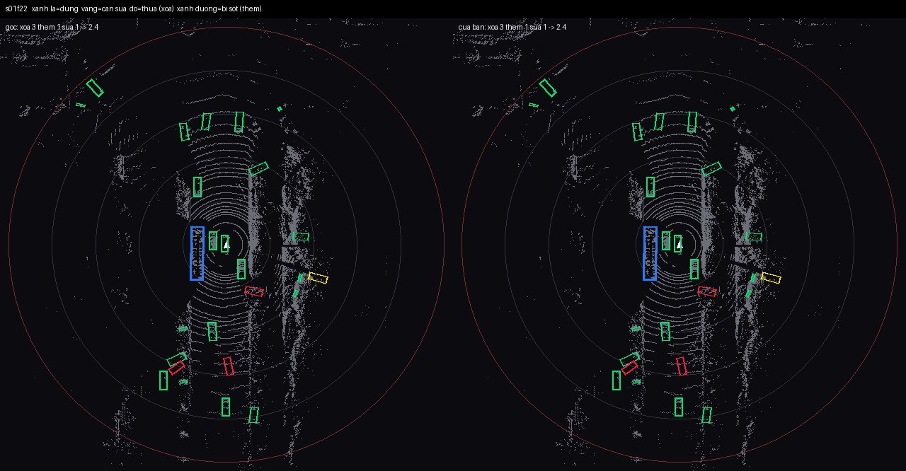
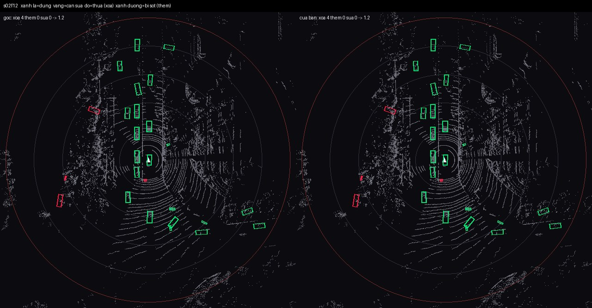
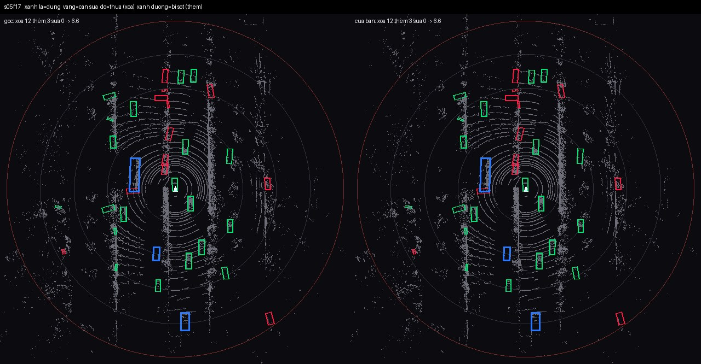

# Báo cáo Day 14 — Nguyễn Thanh Quang — 2A202603083

**Báo cáo cá nhân:** `report/individual/2A202603083_NguyenThanhQuang.md`

- **Họ và tên:** Nguyễn Thanh Quang
- **MSSV:** `2A202603083`
- **Mã học viên dùng với `--student`:** `083`
- **seed_tag:** `393590736f`
- **Frames A:** `s01f22`, `s02f12`, `s05f17`
- **Frames B:** 12 frame được liệt kê trong `d14_083/frames_B.txt`

---

## 1. Dự đoán trước Sweep (bước 5b)

Tôi chưa ghi lại giả thuyết cá nhân trước khi chạy `scripts/pp_sweep.py`. Vì vậy, tôi không thể xác nhận một dự đoán đã được đưa ra trước thực nghiệm hoặc đánh giá giả thuyết đó đúng hay sai sau khi có kết quả.

Phần phân tích tham số dưới đây được trình bày dựa trên kết quả Sweep thực tế, không được xem là dự đoán trước thực nghiệm.

## 2. Tập A: sửa tay và tune

### 2.1. Kết quả Baseline

Baseline được thực hiện trên 3 frame A với reference hiện hành `d14_083/ref_A.json`.

| Cấu hình | Xóa | Thêm | Sửa | Chi phí |
|---|---:|---:|---:|---:|
| Cấu hình gốc | 19 | 4 | 1 | 10.2 |
| `best_config.json` | 19 | 4 | 1 | 10.2 |

Baseline có 69 nhãn thô trong `ref_A.json`; 68 nhãn nằm trong phạm vi chấm không quá 50 m. Chi phí được tính trên 68 nhãn thuộc phạm vi đánh giá.

### 2.2. Đối chiếu CVAT và Ground Truth

Task `D14-083-A` (ID `27`) có 65 shapes và 0 tracks.

Export mới từ CVAT tại `.agent-cache/ref_A_from_cvat.json` có số lượng:

| Frame | Số shapes trong CVAT export | Số nhãn trong `ref_A.json` |
|---|---:|---:|
| `s01f22` | 20 | 24 |
| `s02f12` | 22 | 22 |
| `s05f17` | 23 | 23 |
| **Tổng** | **65** | **69** |

Có 4 box Car chênh lệch trong frame `s01f22`. Các tâm box theo tọa độ mét (x, y) lần lượt là:

- `(30.2069, -36.0258)`
- `(-7.3362, -17.4185)`
- `(-17.0602, -1.8299)`
- `(-20.8641, 7.9990)`

Khoảng cách từ các tâm này đến box CVAT gần nhất lần lượt là `5.140 m`, `11.618 m`, `9.386 m` và `3.974 m`.

Kết quả đánh giá khi sử dụng hai nguồn reference:

| Reference | Xóa | Thêm | Sửa | Chi phí |
|---|---:|---:|---:|---:|
| `ref_A.json` hiện hành | 19 | 4 | 1 | 10.2 |
| Export mới từ CVAT | 23 | 4 | 0 | 10.9 |

LiDAR audit cho 4 box chênh lệch ghi nhận lần lượt 36, 165, 125 và 92 raw points nằm trong các cuboid. Mỗi cuboid chiếu được lên ít nhất một camera. Tuy nhiên, sự hiện diện của các điểm LiDAR chưa đủ để kết luận class hoặc xác định box nào là Ground Truth cuối cùng.

Do chưa có xác nhận cuối cùng từ người phụ trách dữ liệu, báo cáo giữ nguyên `ref_A.json` đã sử dụng khi chạy Sweep và không tự ý chỉnh sửa Ground Truth.

Ảnh kiểm tra nội bộ: `.agent-cache/ref_only4_s01f22.jpg`.

### 2.3. Cảnh báo prediction

Trong frame `s05f17`, prediction có một box cần kiểm tra thủ công:

- `pp_id=30`
- Class: `Pedestrian`
- Score: `0.2247`
- Chiều dài: `1.4764 m`
- Cảnh báo: `warn=l`

Box này cần được người gán nhãn kiểm tra lại trên CVAT. Reference chưa bị thay đổi để xử lý cảnh báo này.

### 2.4. Kết quả Sweep

Đã chạy `scripts/pp_sweep.py` với 15 cấu hình, kết hợp 5 giá trị `score_thr` và 3 giá trị `min_points`, trên 3 frame A.

Các giá trị được thử:

- `score_thr`: 0.1, 0.2, 0.3, 0.4, 0.5
- `min_points`: 0, 5, 10

Kết quả chi phí của 15 cấu hình:

| score_thr | min_points | Chi phí | Xóa | Thêm | Sửa |
|---:|---:|---:|---:|---:|---:|
| 0.1 | 0 | **10.2** | 19 | 4 | 1 |
| 0.1 | 5 | 10.3 | 16 | 5 | 1 |
| 0.1 | 10 | 10.3 | 16 | 5 | 1 |
| 0.2 | 0 | 11.6 | 17 | 6 | 1 |
| 0.2 | 5 | 12.3 | 16 | 7 | 1 |
| 0.2 | 10 | 12.3 | 16 | 7 | 1 |
| 0.3 | 0 | 16.0 | 10 | 13 | 0 |
| 0.3 | 5 | 16.7 | 9 | 14 | 0 |
| 0.3 | 10 | 16.7 | 9 | 14 | 0 |
| 0.4 | 0 | 26.1 | 7 | 24 | 0 |
| 0.4 | 5 | 26.1 | 7 | 24 | 0 |
| 0.4 | 10 | 26.1 | 7 | 24 | 0 |
| 0.5 | 0 | 36.6 | 2 | 36 | 0 |
| 0.5 | 5 | 36.6 | 2 | 36 | 0 |
| 0.5 | 10 | 36.6 | 2 | 36 | 0 |

**Cấu hình tốt nhất trong lưới thử nghiệm:**

- `score_thr = 0.1`
- `min_points = 0`
- Chi phí: `10.2`
- Xóa: 19
- Thêm: 4
- Sửa: 1

Các tham số còn lại được giữ nguyên theo cấu hình gốc trong `best_config.json`, bao gồm:

- `voxel_size=0.16`
- `intensity_mode=clip`
- `intensity_scale=1.0`
- `ground_mode=fixed`
- `delta_z=0.0`
- `passes=4`
- `nms_thr=0.01`
- `nms_pre=100`
- `max_num=50`
- `range_m=50.0`
- `merge_nms_thr=0.1`
- `size_pad_m=0.1`

### 2.5. Kết quả Leave-one-out

| Frame bị bỏ ra | Cấu hình được chọn | Chi phí | Mức tốt nhất có thể |
|---|---|---:|---:|
| `s01f22` | `score_thr=0.1`, `min_points=0` | 2.4 | 2.4 |
| `s02f12` | `score_thr=0.1`, `min_points=0` | 1.2 | 0.6 |
| `s05f17` | `score_thr=0.1`, `min_points=0` | 6.6 | 6.6 |

Cấu hình được chọn đạt mức chi phí tốt nhất có thể trên `s01f22` và `s05f17`. Trên `s02f12`, chi phí là 1.2, cao hơn mức tốt nhất có thể là 0.6.

Kết quả cho thấy cấu hình được chọn hoạt động tương đối ổn định trên 3 frame A, nhưng chưa phải cấu hình tối ưu tuyệt đối cho từng frame riêng lẻ.

Ngoài ra, khi tăng `score_thr` từ 0.1 lên 0.5, chi phí tăng từ 10.2 lên 36.6. Số box cần xóa giảm nhưng số box cần thêm tăng đáng kể. Điều này cho thấy ngưỡng confidence quá cao có thể khiến nhiều vật thể bị bỏ sót.

Việc tăng `min_points` từ 0 lên 5 hoặc 10 trong thử nghiệm này cũng không giúp giảm chi phí tổng thể.

## 3. So sánh trước và sau (bước 8)

### 3.1. Ảnh so sánh

Các ảnh được tạo bởi `scripts/pp_compare.py`:

**Frame s01f22**

**Frame s02f12**

**Frame s05f17**

### 3.2. Kết quả

Kết quả so sánh chi phí trên từng frame:

| Frame | Chi phí cấu hình gốc | Chi phí sau tuning |
|---|---:|---:|
| `s01f22` | 2.4 | 2.4 |
| `s02f12` | 1.2 | 1.2 |
| `s05f17` | 6.6 | 6.6 |
| **Tổng** | **10.2** | **10.2** |

Mức thay đổi công sửa:

\[
\frac{10.2-10.2}{10.2}\times100=0\%
\]

Như vậy, chi phí chỉnh sửa sau tuning không giảm cũng không tăng so với cấu hình gốc.

**Nhận xét:**

Kết quả `pp_compare.py` cho biết không có tham số nào thay đổi so với cấu hình gốc. Sweep đã chọn lại cấu hình có `score_thr=0.1` và `min_points=0`, chính là cấu hình gốc trong phạm vi tham số được thử nghiệm.

Do đó, quá trình Sweep đã xác định được cấu hình có chi phí thấp nhất trong lưới thử nghiệm, nhưng chưa tạo ra cải thiện về công chỉnh sửa trên tập A.

Vì không có giả thuyết được ghi nhận trước Sweep, tôi không kết luận dự đoán ban đầu đúng hay sai. Kết luận được rút ra từ số liệu thực nghiệm là việc tăng `score_thr` làm chi phí tăng rõ rệt trong tập thử nghiệm này.

## 4. Tập B

**Trạng thái: Đã hoàn thành quy trình tạo prediction, gán nhãn CVAT, export reference và đánh giá.**

Tập B gồm 12 frame trong `d14_083/frames_B.txt`. Prediction được sinh bằng cấu hình `d14_083/best_config.json`, sau đó được đưa lên CVAT để kiểm tra và chỉnh sửa thủ công.

### 4.1. Thông tin Task B

- CVAT Task: `D14-083-B`
- Task ID: `28`
- Số frame: 12
- Số cuboid prediction được upload: 349
- File prediction: `d14_083/pred_B.json`
- File Ground Truth export: `d14_083/ref_B.json`
- Đường dẫn CVAT: `http://localhost:8080/tasks/28`

### 4.2. Kết quả prediction

| Frame | Số box prediction |
|---|---:|
| `s02f01` | 30 |
| `s02f19` | 31 |
| `s02f34` | 30 |
| `s03f08` | 25 |
| `s03f32` | 42 |
| `s03f57` | 39 |
| `s04f12` | 27 |
| `s04f31` | 22 |
| `s04f58` | 22 |
| `s05f04` | 27 |
| `s05f29` | 29 |
| `s05f44` | 25 |
| **Tổng** | **349** |

Trong quá trình tạo prediction, có cảnh báo kích thước tại ba frame `s02f01`, `s02f19` và `s05f44`. Mỗi frame có một cảnh báo. Các cảnh báo này được lưu ý khi kiểm tra và chỉnh sửa nhãn.

### 4.3. Tạo Task B và chỉnh sửa trên CVAT

Task B được tạo với thông tin:

- Tên task: `D14-083-B`
- CVAT Task ID: `28`
- Số frame: 12
- Số cuboid pre-label được upload: 349

Sau khi upload thành công, tôi đã kiểm tra và chỉnh sửa thủ công các cuboid trên CVAT cho đủ 12 frame.

Các thao tác bao gồm kiểm tra vị trí và kích thước cuboid, class, hướng vật thể; xóa dự đoán không phù hợp và bổ sung hoặc chỉnh sửa nhãn khi cần thiết.

### 4.4. Export Ground Truth

Đã export Ground Truth từ CVAT thành công vào:

`d14_083/ref_B.json`

Kết quả log export theo từng frame:

| Frame | Box trong log export |
|---|---:|
| `s02f01` | 26 |
| `s02f19` | 26 |
| `s02f34` | 22 |
| `s03f08` | 21 |
| `s03f32` | 20 |
| `s03f57` | 22 |
| `s04f12` | 17 |
| `s04f31` | 17 |
| `s04f58` | 14 |
| `s05f04` | 17 |
| `s05f29` | 19 |
| `s05f44` | 20 |
| **Tổng** | **241** |

File `ref_B.json` tồn tại và có đủ 12 frame.

### 4.5. Kết quả Evaluation Task B

Đã chạy `scripts/pp_prelabel.py` với `frames_B.txt`, `best_config.json` và `ref_B.json`.

Kết quả theo evaluator:

| Frame | Xóa | Thêm | Sửa | Chi phí |
|---|---:|---:|---:|---:|
| `s02f01` | 5 | 1 | 0 | 2.5 |
| `s02f19` | 6 | 1 | 1 | 3.3 |
| `s02f34` | 9 | 0 | 0 | 2.7 |
| `s03f08` | 6 | 2 | 1 | 4.3 |
| `s03f32` | 23 | 1 | 0 | 7.9 |
| `s03f57` | 19 | 2 | 0 | 7.7 |
| `s04f12` | 13 | 1 | 0 | 4.9 |
| `s04f31` | 6 | 1 | 0 | 2.8 |
| `s04f58` | 9 | 0 | 0 | 2.7 |
| `s05f04` | 10 | 0 | 3 | 4.5 |
| `s05f29` | 14 | 2 | 0 | 6.2 |
| `s05f44` | 9 | 4 | 0 | 6.7 |
| **Tổng** | **129** | **15** | **5** | **56.2** |

Tổng hợp từ evaluator:

| Chỉ số | Kết quả |
|---|---:|
| Số frame có nhãn | 12 |
| Ground Truth theo evaluator | 235 |
| Prediction | 349 |
| Box khớp | 220 |
| Xóa | 129 |
| Thêm | 15 |
| Sửa | 5 |
| Tổng chi phí | 56.2 |

### 4.6. Phân tích kết quả Task B

Trong 12 frame, `s03f32` có chi phí chỉnh sửa cao nhất với 7.9, tiếp theo là `s03f57` với 7.7. Frame `s02f01` có chi phí thấp nhất là 2.5.

Các frame có chi phí cao nhất:

1. `s03f32`: cost 7.9, xóa 23 box.
2. `s03f57`: cost 7.7, xóa 19 box.
3. `s05f44`: cost 6.7, xóa 9 box và thêm 4 box.
4. `s05f29`: cost 6.2, xóa 14 box.

Kết quả cho thấy số lượng prediction ban đầu tương đối lớn, nhưng vẫn có nhiều box không được giữ lại trong Ground Truth cuối cùng. Vì vậy, pre-label có tác dụng tạo nhãn khởi đầu, nhưng không thể thay thế việc kiểm tra và hiệu chỉnh thủ công.

**Lưu ý về chênh lệch số lượng Ground Truth:**

Tổng số box trong log export CVAT theo từng frame là 241, trong khi evaluator ghi nhận 235 GT. Chênh lệch 6 box này chưa được xác định nguyên nhân.

Báo cáo giữ nguyên cả hai số liệu theo đúng log thực tế: 241 là tổng số lượng trong log export, 235 là số GT evaluator sử dụng. Không tự ý sửa `ref_B.json` hoặc kết quả evaluator. Cần kiểm tra cách evaluator lọc và tính số box trước khi kết luận đây là lỗi dữ liệu.

Chưa có thống kê chi phí theo từng class, vì vậy chưa thể kết luận class nào tốn công chỉnh sửa nhất.

## 5. Giới hạn

1. **Số lượng frame dùng để tune còn ít:** Tập A chỉ có 3 frame, vì vậy cấu hình có chi phí thấp trên tập A chưa chắc đạt hiệu quả tương tự trên các frame hoặc sequence khác.

2. **Giới hạn của model và tập dữ liệu huấn luyện:** Model PointPillars sử dụng trong bài có thể không nhận diện tốt các loại phương tiện hoặc vật thể không thuộc những class được huấn luyện. Những đối tượng này có thể bị bỏ sót hoặc phân loại không chính xác.

3. **Chi phí đánh giá chỉ là chỉ số ước lượng:** Chi phí xóa, thêm và sửa được tính theo công thức của bài lab, không phản ánh chính xác thời gian và mức độ khó khi con người sửa nhãn trên CVAT.

4. **Ảnh hưởng của mật độ điểm LiDAR:** Vật thể ở xa hoặc có ít điểm LiDAR có thể khó được phát hiện chính xác. Tăng `min_points` có thể loại bỏ box nhiễu nhưng cũng có nguy cơ bỏ sót vật thể thật.

5. **Sự chưa thống nhất giữa CVAT và reference Task A:** Bốn box Car trong `s01f22` có sự khác biệt giữa export CVAT và `ref_A.json`. Khi Ground Truth chưa được xác nhận, các chỉ số đánh giá trên tập A cần được xem là kết quả theo reference đang sử dụng, không phải kết luận cuối cùng về chất lượng nhãn.

6. **Giới hạn của việc tìm kiếm tham số:** Lưới Sweep chỉ thử 15 tổ hợp của `score_thr` và `min_points`. Cấu hình tốt nhất trong lưới thử nghiệm không đồng nghĩa với cấu hình tối ưu cho mọi dữ liệu hoặc mọi tham số của model.

7. **Chênh lệch số box Task B:** Log export CVAT có tổng 241 box, trong khi evaluator ghi nhận 235 GT. Cần xác minh cách evaluator lọc hoặc tính box để giải thích chênh lệch này.

8. **Chưa có phân tích theo class:** Kết quả Evaluation hiện có thống kê tổng số xóa, thêm, sửa và cost theo frame, chưa có thống kê chi phí theo từng class Car, Cyclist và Pedestrian.

---

## 6. Kết luận

### Task A

Đã hoàn thành chạy Sweep với 15 cấu hình, chọn được `score_thr=0.1`, `min_points=0` và chạy Compare trên 3 frame. Chi phí sau tuning là 10.2, bằng chi phí cấu hình gốc, tương ứng mức giảm công sửa 0%.

Tuy nhiên, còn chênh lệch 4 box Car giữa CVAT export và `ref_A.json` ở frame `s01f22`. Vì vậy, kết quả Task A cần được hiểu là kết quả theo reference hiện tại, chưa phải kết luận cuối cùng về Ground Truth.

### Task B

Đã hoàn thành sinh `pred_B.json`, tạo CVAT Task ID 28, chỉnh sửa nhãn trên 12 frame, export `ref_B.json` và chạy đánh giá.

Evaluator ghi nhận 129 box cần xóa, 15 box cần thêm, 5 box cần sửa và tổng chi phí 56.2.

Còn một điểm cần xác minh là tổng số box theo log export CVAT là 241, trong khi evaluator sử dụng 235 box GT.

### Tổng kết Day 14

Các bước thực nghiệm chính của Task A và Task B đã được thực hiện. Các kết quả, cấu hình và file dữ liệu cá nhân đã được lưu trong thư mục `d14_083/`.

Báo cáo giữ rõ hai điểm chưa được xác minh:

- Chênh lệch 4 box giữa CVAT export và `ref_A.json` ở Task A.
- Chênh lệch 6 box giữa log export CVAT và số GT evaluator sử dụng ở Task B.

Các bước tiếp theo là kiểm tra lần cuối các file đầu ra, rà soát nội dung cần commit, push lên GitHub và hoàn tất việc nộp bài trên LMS theo yêu cầu của lớp.